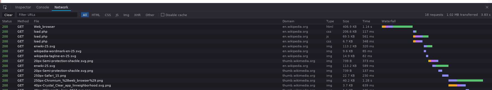
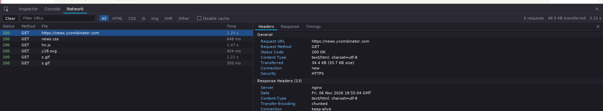
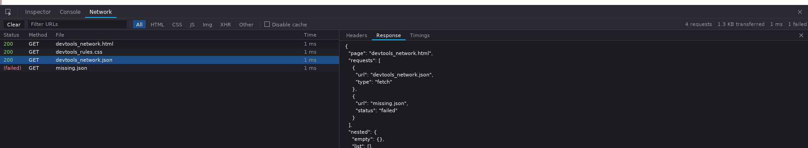
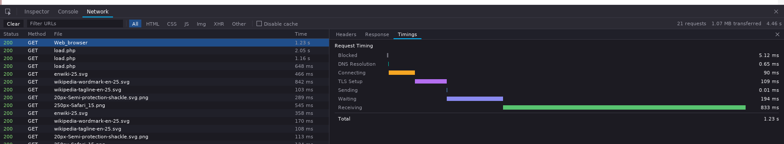
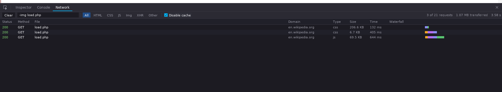
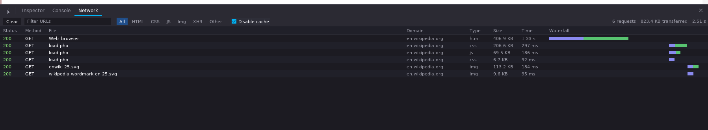

# Network request details, filter and Disable cache: measurements

Linux, Release build, `systemd-run --user --scope -p MemoryMax=1500M`, the
DevTools panel open on the Network tab (F12, then Network). Peak RSS is the
browser process's `VmHWM` 12 s after start.

| Page | main (519f67d) | this branch | this branch, a request selected |
| :--- | :--- | :--- | :--- |
| Wikipedia article (Web_browser) | 126.0 / 127.4 MB | 125.7 / 124.5 MB | 123.8 / 127.7 MB (Timings tab) |
| Hacker News front page | 111.7 / 111.4 MB | 110.5 / 110.3 MB | 109.5 MB (Headers tab) |

The list is now built from slim copies of the entries (no headers or bodies)
each frame; only the selected request is copied in full. Text bodies are kept
up to 64 KB per request and the log is cleared on navigation, so a Wikipedia
article keeps about 350 KB of body text.

## Disable cache

Wikipedia, reloaded (F5) with the panel open, 23 s after start:

| | requests after the reload | images |
| :--- | :--- | :--- |
| Disable cache off | 4 (html, 2 css, 1 js) | 0: all from the image cache |
| Disable cache on | 6 and more as images come into view | fetched again, with `Cache-Control: no-cache` |

A refetched image replaces the pixels of the texture it had (NXRender
`updateTexture`), so boxes showing it follow and no texture is leaked. Animated
GIFs stay cached (their frames can't be replaced in place).

## Screenshots

