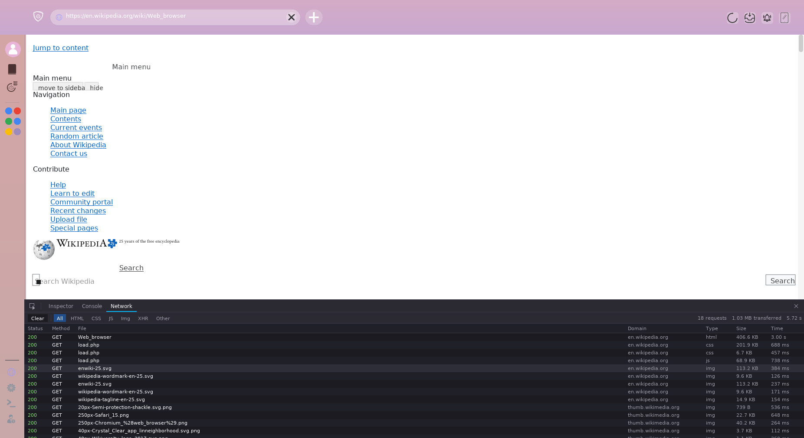

# Network panel and HTTP keep-alive: measurements

Linux, Release build, `systemd-run --user --scope -p MemoryMax=1500M`, home
broadband in India (the round trip to Hacker News is about 300 ms; `curl
--http1.1` needs 1.4–1.6 s for the Hacker News document alone, 0.3 s of it
TCP connect, 0.3–0.6 s TLS, the rest the server). Times are from process
start, taken from the browser's log with a timestamping filter.

## Hacker News (https://news.ycombinator.com)

| | main (3a7b194) | this branch |
| :--- | :--- | :--- |
| document fetched | 2.2 s | 2.0 s |
| `news.css` requested → `hn.js` requested | 2.3 s → 3.8 s (one after the other) | 2.03 s → 2.03 s (together) |
| `load` event fired | **5.5 s** (earlier runs: 5.4 s; the owner measured 8–17 s) | **3.1 s / 3.5 s** (two runs) |
| peak RSS | 100.6 MB | 97.2 MB |

The document itself is now the whole budget: the browser fetches it in
1.9–2.0 s where `curl` needs 1.4–1.8 s for the same URL (Hacker News builds
its front page per request, 0.9–2.2 s server time in our harness). The
stylesheet and script are requested at the same moment the document is
parsed and reuse the document's connection (keep-alive) or a second one.

## Wikipedia article (https://en.wikipedia.org/wiki/Web_browser)

| | main | this branch |
| :--- | :--- | :--- |
| `load` event fired | not measured | 3.2–3.9 s |
| requests in the Network panel | 1 (the document) | 18: html, 2 css, 1 js, 14 img |
| transferred | — | 1.03 MB |
| peak RSS | — | 116–121 MB |

## What changed in the client (NXNet `fix/http-keepalive` + this PR)

- A response is read exactly to the end its headers announce: Content-Length,
  chunked (extensions and trailers), no body for 1xx/204/304/HEAD, or until
  the server closes. No more 1 s `poll()` before the first byte and 50 ms idle
  wait after the last one, and no response cut short because TLS had already
  decrypted the rest (`SSL_pending`).
- Kept-alive connections go back to a per-host pool shared by every
  `HttpClient` (the loader threads included); a request on a connection the
  server closed is retried once on a new one. TLS sessions of verified
  handshakes are resumed on reconnect; certificate verification is per socket.
- The browser requests every stylesheet and external script of a page at once
  before its sequential load passes reach them (`prefetchResource`).

## Tests

- `nxhttp_tests`: `HttpFraming.*` (Content-Length stops at the body, chunked
  with extensions and trailers, truncated chunked is incomplete, 204/304/HEAD,
  close-delimited, HTTP/1.0 keep-alive, interim 1xx responses, bad status
  lines), `HttpKeepAlive.*` (an in-process server: three requests on one
  connection, `Connection: close` opens a new one, four threads share the
  pool), `NetworkMonitorThreads.*` (four writers and a reader at once; errors,
  clear while in flight, callbacks outside the lock).
- `webcore_dom_bindings_tests`: `FetchBindings.*` (fetch resolves on the
  timer pump with `json()`, `text()`, failures reject with a TypeError, body
  used twice, XMLHttpRequest events and headers, `responseType = 'json'`,
  abort, a page closed with a request in flight, no handler installed).
